# Relais — safety case

> **Standing.** Relais is a demonstrator *aligned with* annex 6 of UN
> Regulation No. 79. It is **not** compliant, not approved and not certifiable:
> it is a small-scale, emulated answer to the annex's question — "explain your
> switch-over mechanism". Every latency quoted here is a **measured worst case
> under emulation**, never a proven worst case.

This document **assembles** the safety case from the generated artefacts; it
does not hand-copy them. The FMEA table is the output of
`host/safety/fmea.py` (which reads `docs/TRUTH-TABLE.md` and the fault model of
[`SPEC.md` §3.3](SPEC.md)); the fault tree is the output of `host/safety/fta.py`.
Edit those scripts — and the truth table they read — not the tables here.

The design's full principle, logic and redundancy are laid out in
[`docs/SAFETY.md`](SAFETY.md). This document **complements** it without
duplicating it: SAFETY.md explains *how* the switch-over works; this document
states *why it is safe enough to demonstrate*, in the three views the annex asks
for — a failure-mode analysis, a fault tree, and a claim about double command.

---

## 1. Safety goal

The actuator must never stay without a fresh command for longer than a bounded,
measured interval, and it must never apply the command of a machine that has
been deposed (see SAFETY.md §1 for the full statement). The safe state is the
actuator's own damped loop: hold the rack, red lamp, request a stop (DEG-05).

## 2. Concept, in one sentence

The actuator is the arbiter **and** the clock: it hands out mandate numbers,
withdraws them only on its own evidence (p+1 ticks of silence, or a cession),
and applies exactly one value per tick. Two machines that disagree therefore
cannot both command — only the appointed holder's order, for the tick to come,
is obeyed.

## 3. Failure-mode and effects analysis (FMEA)

Generated by `host/safety/fmea.py`; do not edit by hand. The modes, causes, effects, requirements and coverage are parsed from the truth table and the spec-3.3 fault model. The S/O/D ratings and the criticality are engineering judgement, **not** measurements.

| ID | Mode | Cause | Local effect | System effect | Detection | Severity (S) | Occurrence (O) | Detectability (D) | Criticality (S*O*D) | Mitigation | Requirements | Coverage |
|---|---|---|---|---|---|---|---|---|---|---|---|---|
| F1 | Death of one machine | A (holder) dies (F1) | No more order from A; No more `OMBRE` | Handover to B within p+2 ticks; will bridges the gap; yellow lamp "second/holder state" per DEG-02; No handover; yellow lamp "second absent"; holder keeps commanding | p+1 consecutive ticks without a valid order, counted by the actuator | 9 | 4 | 2 | 72 | revoke and auto-switch to the certified second, or grant on demande; handover within p+2 ticks (REL-01) | REL-01, REL-02, MAN-04, MAN-10, DEG-01; DEG-01, DEG-02, REP-05 (decertification) | Explorer; simulator; QEMU bench (INJ-02, sweep INJ-08); mutant M3 must be flagged; QEMU bench |
| F2 | Freeze then resumption, any duration | A freezes, then comes back — the returning machine (F2) | No order, then stale orders (old mandate, old tick); An isolated miss | Handover to B; A's orders dropped twice over (not holder, past tick); A reads the `STATUT`, stops emitting, rejoins as second; No handover; will or shadow bridges; A stays holder; nothing to report | stale orders are dropped by mandate number and tick label (MAN-08) | 9 | 4 | 3 | 108 | handover; the revenant reads the STATUT, stops emitting, rejoins as second | MAN-02, MAN-08, REL-07, DEG-07, ACT-09; DET-03, MAN-04 | Explorer; QEMU bench (`stop`/`cont`, INJ-03); mutants M2, M7; simulator; QEMU bench (short freezes, ROB-05) |
| F3 | Slow machine, missing ticks | A slow, isolated misses (F3; also F6 losses) | Non-consecutive misses | No handover (loss of p consecutive orders changes nothing); miss counter published in every `STATUT` | miss counter published in every STATUT (DET-03) | 8 | 5 | 4 | 160 | deposed only when the misses are consecutive; intermittent misses absorbed | DET-03, ROB-03, ROB-08, MAN-07 | Explorer; simulator (loss/delay model); QEMU bench (INJ-09 slow machine) |
| F4 | Inter-computer link cut, one or both ways | Link between computers cut, one or both ways (F4) | Nothing abnormal | No handover; B follows the `STATUT`s and rebuilds a bump-free state from what the actuator publishes; yellow lamp "link lost" within 2 ticks | loss of ETAT detected after two ticks (DET-06) | 6 | 4 | 3 | 72 | no handover; the second rebuilds a bump-free state from the STATUT; yellow "link lost" | DET-06, REP-04, REP-07, DEG-01 | Explorer (half-link cuts); QEMU bench (`set_link`, INJ-04/05) |
| F5 | Machine–actuator link cut, one or both ways | A–actuator link cut, both directions (F5) | No more order from A; No more order from A (A has no tempo); No more `OMBRE` | Handover to B; A declares itself "without actuator" and deposes itself after `bail_ticks` of silence; A learns its deposition from the `STATUT` it still receives; A deposes itself after 4 ticks without `STATUT` (bail); No handover; yellow lamp; B loses certification after more than p missing shadows | the actuator sees no order; the machine sees no STATUT (DET-07) | 8 | 5 | 2 | 80 | handover if it was the holder; the machine deposes itself after bail_ticks of silence (MAN-09) | DET-07, MAN-09, REL-01; DET-08, MAN-08; MAN-09, DET-07, DET-08; REP-05, DEG-01, DET-08 | Explorer; QEMU bench (INJ-04); Explorer (six half-links, DET-08); QEMU bench |
| F6 | Loss, duplication, reordering, delay of frames | A slow, isolated misses (F3; also F6 losses) | Non-consecutive misses | No handover (loss of p consecutive orders changes nothing); miss counter published in every `STATUT` | tick label, mandate number and CRC reject a reordered or late frame | 7 | 5 | 3 | 105 | dropped and counted; absorbed within the parameter bounds (ROB-02) | DET-03, ROB-03, ROB-08, MAN-07 | Explorer; simulator (loss/delay model); QEMU bench (INJ-09 slow machine) |
| F7 | Corrupted or forged frame | Corrupted or forged frame (F7) | Invalid check (CRC-32C or MAC) | Frame dropped and counted, treated as a loss; no effect on the service | CRC-32C (level S) or SipHash-2-4 MAC (level C) (DET-04) | 8 | 3 | 1 | 24 | dropped, counted and journaled; no effect on the service (SEC-02) | DET-04, SEC-01, SEC-02, SEC-03 | Unit tests (fuzzing ROB-09 at level X); explorer |
| F8 | Wrong value emitted by a machine | A emits wrong values (F8) | `ORDRE` different from the `OMBRE` beyond ε for 3 ticks | "Disagreement" alert, red lamp; full level: plausibility check designates the faulty machine when possible, otherwise the holder is kept | order/shadow comparison over 3 ticks (DET-09) | 10 | 3 | 2 | 60 | disagreement alert, decertification, red lamp; holder kept (detected, not arbitrated: no majority with two machines) | DET-09, DET-10, DEG-01 | Simulator (bias fault); QEMU bench (INJ-10); mutant M5 |
| F9 | Second fault before redundancy is restored | A and B die (F10; F9 if sequential) | Nothing | Will plays out to its horizon, then fallback law at most N+1 ticks after the last fresh order; red lamp; "stop requested" after the bounded degraded duration | not detected directly; reaches the safe state | 10 | 2 | 7 | 140 | will to its horizon, then the local fallback loop (safe state) | ACT-02, ACT-03, DEG-05, DEG-06 | Explorer (two faults, level C); simulator; QEMU bench |
| F10 | Death of both machines | A and B die (F10; F9 if sequential) | Nothing | Will plays out to its horizon, then fallback law at most N+1 ticks after the last fresh order; red lamp; "stop requested" after the bounded degraded duration | not detected directly; reaches the safe state | 10 | 1 | 5 | 50 | will for N ticks, then fallback; red lamp; stop requested (DEG-05) | ACT-02, ACT-03, DEG-05, DEG-06 | Explorer (two faults, level C); simulator; QEMU bench |
| F11 | Failure of the actuator itself | — |  |  | not detected (actuator is a declared single point of failure) | 10 | 1 | 9 | 90 |  |  |  |


### Faults without a mitigation measure nor a test

The generator above flags every fault of the model that carries **no mitigation
measure and no covering test**. As of the current truth table there is exactly
one: **F11, failure of the actuator itself**, which is declared out of scope
(`docs/SAFETY.md` §6-7) and answered only by the level-X extension of two
actuator channels (ACT-10, MAN-13). Everything else has both a barrier and at
least one covering test.

---

## 4. Fault tree

Top event: **"the actuator stays without a fresh order for more than p+1 ticks"**.

If a single fault strikes, one of the three ranks below still provides a value,
so the top event is only reachable as the **AND** of the three subtrees: this is
precisely the double fault (F9 / F10), and the leaves of each subtree name the
barrier that stops the fault before it propagates.

### 4.1 Indented tree

```text
AND: the actuator stays without a fresh order for more than p+1 ticks
    OR: no fresh holder order (rank 1 is lost)
        - holder dies (F1)
          barrier: revoke on p+1 silence, auto-switch to the certified second (MAN-04, REL-01)
        - holder freezes (F2)
          barrier: stale orders dropped by mandate number and tick label; revenant stands down (MAN-08, REL-07)
        - holder misses consecutive ticks (F3)
          barrier: miss counter in every STATUT; deposed only on consecutive misses (DET-03)
        - holder-actuator link cut, one or both ways (F5)
          barrier: handover to the second; the machine deposes itself (REL-01, MAN-09)
        - holder frames lost, duplicated, reordered or delayed (F6)
          barrier: tick label and mandate number; absorbed within the parameters (ROB-02)
        - holder frames corrupted or forged (F7)
          barrier: CRC-32C / SipHash MAC, dropped and counted (DET-04, SEC-02)
    OR: no certified shadow (rank 2 is lost)
        - second dies (F1)
          barrier: no handover; yellow 'second absent'; holder keeps commanding (REP-05, DEG-02)
        - second-actuator link cut (F5)
          barrier: certification lost after more than p missing shadows (REP-05, DET-08)
        - inter-computer link cut (F4)
          barrier: second rebuilds a bump-free state from the STATUT (REP-04, DET-06)
        - second never certified
          barrier: certification streak must be reached before the shadow is applied (REP-05)
    OR: the will cannot keep covering (rank 3 is exhausted)
        - will horizon reached after N+1 ticks without a fresh order
          barrier: local damped fallback loop; red lamp; stop requested (ACT-02, ACT-03, DEG-05)
```

### 4.2 Graphviz DOT

```dot
digraph fault_tree {
  rankdir=TB;
  node [shape=box, fontname="Helvetica", fontsize=10];
  n0 [label="the actuator stays without a fresh order for more than p+1 ticks", shape=box, style=filled, fillcolor="#fde0dc"];
  n1 [label="OR: no fresh holder order (rank 1 is lost)", shape=diamond];
  n2 [label="holder dies (F1)\nbarrier: revoke on p+1 silence, auto-switch to the certified second (MAN-04, REL-01)", shape=ellipse];
  n3 [label="holder freezes (F2)\nbarrier: stale orders dropped by mandate number and tick label; revenant stands down (MAN-08, REL-07)", shape=ellipse];
  n4 [label="holder misses consecutive ticks (F3)\nbarrier: miss counter in every STATUT; deposed only on consecutive misses (DET-03)", shape=ellipse];
  n5 [label="holder-actuator link cut, one or both ways (F5)\nbarrier: handover to the second; the machine deposes itself (REL-01, MAN-09)", shape=ellipse];
  n6 [label="holder frames lost, duplicated, reordered or delayed (F6)\nbarrier: tick label and mandate number; absorbed within the parameters (ROB-02)", shape=ellipse];
  n7 [label="holder frames corrupted or forged (F7)\nbarrier: CRC-32C / SipHash MAC, dropped and counted (DET-04, SEC-02)", shape=ellipse];
  n8 [label="OR: no certified shadow (rank 2 is lost)", shape=diamond];
  n9 [label="second dies (F1)\nbarrier: no handover; yellow 'second absent'; holder keeps commanding (REP-05, DEG-02)", shape=ellipse];
  n10 [label="second-actuator link cut (F5)\nbarrier: certification lost after more than p missing shadows (REP-05, DET-08)", shape=ellipse];
  n11 [label="inter-computer link cut (F4)\nbarrier: second rebuilds a bump-free state from the STATUT (REP-04, DET-06)", shape=ellipse];
  n12 [label="second never certified\nbarrier: certification streak must be reached before the shadow is applied (REP-05)", shape=ellipse];
  n13 [label="OR: the will cannot keep covering (rank 3 is exhausted)", shape=diamond];
  n14 [label="will horizon reached after N+1 ticks without a fresh order\nbarrier: local damped fallback loop; red lamp; stop requested (ACT-02, ACT-03, DEG-05)", shape=ellipse];
  n0 -> n1;
  n0 -> n8;
  n0 -> n13;
  n1 -> n2;
  n1 -> n3;
  n1 -> n4;
  n1 -> n5;
  n1 -> n6;
  n1 -> n7;
  n8 -> n9;
  n8 -> n10;
  n8 -> n11;
  n8 -> n12;
  n13 -> n14;
}
```



---

## 5. Barriers, one per path

| Path | Barrier | Requirement |
|---|---|---|
| holder dies / freezes / misses / link cut | revoke on p+1, auto-switch or handover | MAN-04, REL-01 |
| holder's stale orders | dropped by mandate number and tick label | MAN-08, REL-07 |
| frame loss / delay / reorder | tick label, mandate number, absorbed within bounds | ROB-02 |
| corrupted / forged frame | CRC-32C / SipHash MAC, dropped and counted | DET-04, SEC-02 |
| second dies / link cut / not certified | no handover; certification lost; holder keeps | REP-05, DEG-02 |
| will horizon exhausted | local damped fallback loop, red lamp, stop | ACT-02, ACT-03, DEG-05 |

The full barrier table, the built-in checks and the logic that produces them are
in `docs/SAFETY.md` §4–5 (referred, not copied).

## 6. Why double command is impossible

This is the claim the whole design rests on, stated against the evidence:

1. **The mandate is written by the actuator alone.** A machine never appoints
   itself; the mandate number increases by exactly one per change of holder and
   never decreases (MAN-01, MAN-03). Two machines cannot both believe they hold
   the *same* mandate, because only one number is ever current, and an order
   carrying a future mandate is refused (SEC-04).
2. **A mandate is withdrawn only on the actuator's own evidence** (p+1 ticks of
   silence, or a cession, MAN-04). A machine that loses its link does **not**
   trigger a handover on its own — so the "is it dead, or is the cable cut?"
   dilemma can never produce two masters (REL-04).
3. **An order names the tick it targets** (MAN-02). Whatever a machine believed
   before a freeze is stale by construction: the revenant is disarmed twice
   over, by its mandate number and by its tick label (spec 4.6, REL-07).
4. **The actuator applies exactly one value per tick, in a fixed order**
   (holder order → certified shadow → will → fallback, spec 4.4, ACT-01). Even
   if two machines disagree about who is appointed, only the appointed one is
   obeyed — the other's value is never applied.

Safety does **not** depend on the machines' clocks, nor on frame delays, nor on
their agreement; it follows from the actuator being the sole writer of the
mandate and the sole chooser of the value (I1–I3).

**What verifies this.** The invariant I1–I11 are checked on every tick by the
simulator, the explorer and `relais-verify` (`host/verify/`); the explorer
enumerates the protocol exhaustively — `make explore` records 100 198 states /
0 violation with one fault and 10 000 330 states / 0 violation with two faults
(`docs/RESULTS.md`); the fault-free twin differential test (`host/simulate/`)
shows zero deviation from the reference at every tick; and the mutant bench
`host/mutants/run_mutants.py` flags 8/8 injected defects (M1–M8), including the
two that would break exactly this argument — M3 (grant without evidence of
silence) and M5 (a wrong value that must not smear the holder).

## 7. Residual limits

Stated plainly, and shared with `docs/SAFETY.md` §7 (referred here, not copied):
a machine that computes wrong is **detected, not outvoted** (two machines give
no majority — DET-09, level-X REP-08); a defect common to both copies of the
same binary is out of scope (DEG-08); the actuator is a single point of failure
mitigated by a tiny, fully-explored core and two channels at level X; the
degraded mode is time-limited; timings are emulated; the threat model stops at
frame authentication. Nothing here is claimed — including this safety case
itself — that cannot be reproduced by the commands in `docs/RESULTS.md`.

## 8. Prudence

Relais is *aligned with* annex 6 of UN Regulation No. 79 — never "compliant".
It is a demonstrator whose safety argument is complete *for the emulated scope*
and openly bounded: hardware faults, a third machine vote, and the level-X
actuator redundancy are extensions, listed as such, not claims.