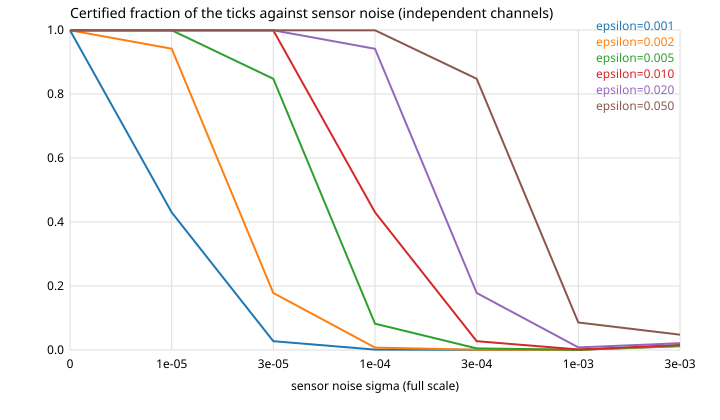

# Relais — sensor noise and the choice of epsilon (mission M30, idea 67)

Measured by `build/relais-physics`, which drives the real core: the arbiter,
two node state machines, the rack and the published control law. No part of
the protocol is re-implemented in this script.

Reproduce:
```
make build/relais-physics
python3 host/physics/epsilon_study.py --seeds 8 --ticks 3000
```

Grid: sigma in {0, 1e-05, 3e-05, 1e-04, 3e-04, 1e-03, 3e-03} (full scale), epsilon in {0.001, 0.002, 0.005, 0.010, 0.020, 0.050}, value fault (INJ-10) in {0.001, 0.002, 0.010, 0.020, 0.050} injected at tick 1000, 8 seeds per point, 3000 ticks per run.

## 1. Certification, independent sensor channels

Fraction of the ticks where the second is certified, with NO fault injected.
A cell marked (!) is below the 99 % target.

| sigma | eps=0.001 | eps=0.002 | eps=0.005 | eps=0.010 | eps=0.020 | eps=0.050 |
|---|---|---|---|---|---|---|
| 0 | 0.999 | 0.999 | 0.999 | 0.999 | 0.999 | 0.999 |
| 1e-05 | 0.430 (!) | 0.942 (!) | 0.999 | 0.999 | 0.999 | 0.999 |
| 3e-05 | 0.028 (!) | 0.178 (!) | 0.848 (!) | 0.999 | 0.999 | 0.999 |
| 1e-04 | 0.001 (!) | 0.007 (!) | 0.082 (!) | 0.430 (!) | 0.941 (!) | 0.999 |
| 3e-04 | 0.001 (!) | 0.001 (!) | 0.005 (!) | 0.028 (!) | 0.178 (!) | 0.848 (!) |
| 1e-03 | 0.001 (!) | 0.001 (!) | 0.001 (!) | 0.002 (!) | 0.008 (!) | 0.086 (!) |
| 3e-03 | 0.012 (!) | 0.013 (!) | 0.014 (!) | 0.016 (!) | 0.021 (!) | 0.048 (!) |

## 2. False alarms, independent sensor channels

Fraction of the runs that raised a disagreement or a decertification BEFORE
any fault was injected. This is the noise alone breaking the band.

| sigma | eps=0.001 | eps=0.002 | eps=0.005 | eps=0.010 | eps=0.020 | eps=0.050 |
|---|---|---|---|---|---|---|
| 0 | 0.00 | 0.00 | 0.00 | 0.00 | 0.00 | 0.00 |
| 1e-05 | 1.00 | 1.00 | 0.00 | 0.00 | 0.00 | 0.00 |
| 3e-05 | 1.00 | 1.00 | 1.00 | 0.38 | 0.00 | 0.00 |
| 1e-04 | 1.00 | 1.00 | 1.00 | 1.00 | 1.00 | 0.00 |
| 3e-04 | 1.00 | 1.00 | 1.00 | 1.00 | 1.00 | 1.00 |
| 1e-03 | 1.00 | 1.00 | 1.00 | 1.00 | 1.00 | 1.00 |
| 3e-03 | 1.00 | 1.00 | 1.00 | 1.00 | 1.00 | 1.00 |

## 3. The noise floor of the comparison

Worst order/shadow gap over the fault-free ticks (full scale).

| sigma | eps=0.001 | eps=0.002 | eps=0.005 | eps=0.010 | eps=0.020 | eps=0.050 |
|---|---|---|---|---|---|---|
| 0 | 0.00000 | 0.00000 | 0.00000 | 0.00000 | 0.00000 | 0.00000 |
| 1e-05 | 0.00356 | 0.00356 | 0.00356 | 0.00356 | 0.00356 | 0.00356 |
| 3e-05 | 0.01069 | 0.01069 | 0.01069 | 0.01069 | 0.01069 | 0.01069 |
| 1e-04 | 0.03564 | 0.03564 | 0.03564 | 0.03564 | 0.03564 | 0.03564 |
| 3e-04 | 0.10693 | 0.10693 | 0.10693 | 0.10693 | 0.10693 | 0.10693 |
| 1e-03 | 0.35644 | 0.35644 | 0.35644 | 0.35644 | 0.35644 | 0.35644 |
| 3e-03 | 0.50000 | 0.50000 | 0.50000 | 0.50000 | 0.50000 | 0.50000 |

## 4. The smallest usable band, and what it costs

Smallest epsilon with zero false alarm and a certified fraction above the
target. That band is also the smallest value fault the actuator can see.
`gap / sigma` is the amplification of the sensor noise by the control law.

| sigma | smallest usable epsilon | smallest visible fault | gap / sigma |
|---|---|---|---|
| 0 | 0.001 | 0.001 | - |
| 1e-05 | 0.005 | 0.005 | 68.5 |
| 3e-05 | 0.020 | 0.020 | 68.5 |
| 1e-04 | 0.050 | 0.050 | 68.5 |
| 3e-04 | - | - | 68.5 |
| 1e-03 | - | - | 66.4 |
| 3e-03 | - | - | 40.2 |

## 5. Detection of a value fault, independent sensor channels

Mean number of ticks between the injection (INJ-10, at tick 1000) and the first
disagreement or decertification. `noise` means that very cell already raises
false alarms with no fault at all, so the delay cannot be attributed to the
fault; `missed` means fewer than half of the runs ever saw it.

### bias = 0.001 (0.1 % of full scale)

| sigma | eps=0.001 | eps=0.002 | eps=0.005 | eps=0.010 | eps=0.020 | eps=0.050 |
|---|---|---|---|---|---|---|
| 0 | 65.0 | missed | missed | missed | missed | missed |
| 1e-05 | noise | noise | missed | missed | missed | missed |
| 3e-05 | noise | noise | noise | noise | missed | missed |
| 1e-04 | noise | noise | noise | noise | noise | missed |
| 3e-04 | noise | noise | noise | noise | noise | noise |
| 1e-03 | noise | noise | noise | noise | noise | noise |
| 3e-03 | noise | noise | noise | noise | noise | noise |

### bias = 0.002 (0.2 % of full scale)

| sigma | eps=0.001 | eps=0.002 | eps=0.005 | eps=0.010 | eps=0.020 | eps=0.050 |
|---|---|---|---|---|---|---|
| 0 | 1.0 | 1.0 | missed | missed | missed | missed |
| 1e-05 | noise | noise | 1000.0 | missed | missed | missed |
| 3e-05 | noise | noise | noise | noise | missed | missed |
| 1e-04 | noise | noise | noise | noise | noise | missed |
| 3e-04 | noise | noise | noise | noise | noise | noise |
| 1e-03 | noise | noise | noise | noise | noise | noise |
| 3e-03 | noise | noise | noise | noise | noise | noise |

### bias = 0.010 (1.0 % of full scale)

| sigma | eps=0.001 | eps=0.002 | eps=0.005 | eps=0.010 | eps=0.020 | eps=0.050 |
|---|---|---|---|---|---|---|
| 0 | 1.0 | 1.0 | 1.0 | 65.0 | missed | missed |
| 1e-05 | noise | noise | 1.0 | 1.6 | missed | missed |
| 3e-05 | noise | noise | noise | noise | missed | missed |
| 1e-04 | noise | noise | noise | noise | noise | missed |
| 3e-04 | noise | noise | noise | noise | noise | noise |
| 1e-03 | noise | noise | noise | noise | noise | noise |
| 3e-03 | noise | noise | noise | noise | noise | noise |

### bias = 0.020 (2.0 % of full scale)

| sigma | eps=0.001 | eps=0.002 | eps=0.005 | eps=0.010 | eps=0.020 | eps=0.050 |
|---|---|---|---|---|---|---|
| 0 | 1.0 | 1.0 | 1.0 | 1.0 | 1.0 | missed |
| 1e-05 | noise | noise | 1.0 | 1.0 | 1.6 | missed |
| 3e-05 | noise | noise | noise | noise | 1.6 | missed |
| 1e-04 | noise | noise | noise | noise | noise | 1000.0 |
| 3e-04 | noise | noise | noise | noise | noise | noise |
| 1e-03 | noise | noise | noise | noise | noise | noise |
| 3e-03 | noise | noise | noise | noise | noise | noise |

### bias = 0.050 (5.0 % of full scale)

| sigma | eps=0.001 | eps=0.002 | eps=0.005 | eps=0.010 | eps=0.020 | eps=0.050 |
|---|---|---|---|---|---|---|
| 0 | 1.0 | 1.0 | 1.0 | 1.0 | 1.0 | 1.0 |
| 1e-05 | noise | noise | 1.0 | 1.0 | 1.0 | 1.6 |
| 3e-05 | noise | noise | noise | noise | 1.0 | 1.6 |
| 1e-04 | missed | noise | noise | noise | noise | 1.6 |
| 3e-04 | noise | noise | noise | noise | noise | noise |
| 1e-03 | noise | noise | noise | noise | noise | noise |
| 3e-03 | noise | noise | noise | noise | noise | noise |

## 6. Detection rate, independent sensor channels

Fraction of the runs where the actuator saw the fault at least once.

### bias = 0.001

| sigma | eps=0.001 | eps=0.002 | eps=0.005 | eps=0.010 | eps=0.020 | eps=0.050 |
|---|---|---|---|---|---|---|
| 0 | 1.00 | 0.00 | 0.00 | 0.00 | 0.00 | 0.00 |
| 1e-05 | 1.00 | 1.00 | 0.00 | 0.00 | 0.00 | 0.00 |
| 3e-05 | 1.00 | 1.00 | 1.00 | 0.50 | 0.00 | 0.00 |
| 1e-04 | 1.00 | 1.00 | 1.00 | 1.00 | 1.00 | 0.00 |
| 3e-04 | 1.00 | 1.00 | 1.00 | 1.00 | 1.00 | 1.00 |
| 1e-03 | 1.00 | 1.00 | 1.00 | 1.00 | 1.00 | 1.00 |
| 3e-03 | 1.00 | 1.00 | 1.00 | 1.00 | 1.00 | 1.00 |

### bias = 0.002

| sigma | eps=0.001 | eps=0.002 | eps=0.005 | eps=0.010 | eps=0.020 | eps=0.050 |
|---|---|---|---|---|---|---|
| 0 | 1.00 | 1.00 | 0.00 | 0.00 | 0.00 | 0.00 |
| 1e-05 | 1.00 | 1.00 | 0.50 | 0.00 | 0.00 | 0.00 |
| 3e-05 | 1.00 | 1.00 | 1.00 | 1.00 | 0.00 | 0.00 |
| 1e-04 | 1.00 | 1.00 | 1.00 | 1.00 | 1.00 | 0.00 |
| 3e-04 | 1.00 | 1.00 | 1.00 | 1.00 | 1.00 | 1.00 |
| 1e-03 | 1.00 | 1.00 | 1.00 | 1.00 | 1.00 | 1.00 |
| 3e-03 | 1.00 | 1.00 | 1.00 | 1.00 | 1.00 | 1.00 |

### bias = 0.010

| sigma | eps=0.001 | eps=0.002 | eps=0.005 | eps=0.010 | eps=0.020 | eps=0.050 |
|---|---|---|---|---|---|---|
| 0 | 1.00 | 1.00 | 1.00 | 1.00 | 0.00 | 0.00 |
| 1e-05 | 1.00 | 1.00 | 1.00 | 1.00 | 0.00 | 0.00 |
| 3e-05 | 1.00 | 1.00 | 1.00 | 1.00 | 0.12 | 0.00 |
| 1e-04 | 1.00 | 1.00 | 1.00 | 1.00 | 1.00 | 0.00 |
| 3e-04 | 1.00 | 1.00 | 1.00 | 1.00 | 1.00 | 1.00 |
| 1e-03 | 1.00 | 1.00 | 1.00 | 1.00 | 1.00 | 1.00 |
| 3e-03 | 1.00 | 1.00 | 1.00 | 1.00 | 1.00 | 1.00 |

### bias = 0.020

| sigma | eps=0.001 | eps=0.002 | eps=0.005 | eps=0.010 | eps=0.020 | eps=0.050 |
|---|---|---|---|---|---|---|
| 0 | 1.00 | 1.00 | 1.00 | 1.00 | 1.00 | 0.00 |
| 1e-05 | 1.00 | 1.00 | 1.00 | 1.00 | 1.00 | 0.00 |
| 3e-05 | 0.75 | 0.88 | 1.00 | 1.00 | 1.00 | 0.00 |
| 1e-04 | 1.00 | 1.00 | 1.00 | 1.00 | 1.00 | 0.50 |
| 3e-04 | 1.00 | 1.00 | 1.00 | 1.00 | 1.00 | 1.00 |
| 1e-03 | 1.00 | 1.00 | 1.00 | 1.00 | 1.00 | 1.00 |
| 3e-03 | 1.00 | 1.00 | 1.00 | 1.00 | 1.00 | 1.00 |

### bias = 0.050

| sigma | eps=0.001 | eps=0.002 | eps=0.005 | eps=0.010 | eps=0.020 | eps=0.050 |
|---|---|---|---|---|---|---|
| 0 | 1.00 | 1.00 | 1.00 | 1.00 | 1.00 | 1.00 |
| 1e-05 | 1.00 | 1.00 | 1.00 | 1.00 | 1.00 | 1.00 |
| 3e-05 | 0.75 | 0.88 | 1.00 | 1.00 | 1.00 | 1.00 |
| 1e-04 | 0.25 | 0.75 | 0.75 | 1.00 | 1.00 | 1.00 |
| 3e-04 | 1.00 | 1.00 | 1.00 | 1.00 | 1.00 | 1.00 |
| 1e-03 | 1.00 | 1.00 | 1.00 | 1.00 | 1.00 | 1.00 |
| 3e-03 | 1.00 | 1.00 | 1.00 | 1.00 | 1.00 | 1.00 |

## 7. The published architecture: one shared measurement

The actuator publishes the measurement and both computers use it, so the
noise moves the command but never the comparison. Certified fraction, then
detection delay for a 2 % fault.

| sigma | eps=0.001 | eps=0.002 | eps=0.005 | eps=0.010 | eps=0.020 | eps=0.050 |
|---|---|---|---|---|---|---|
| 0 | 0.999 | 0.999 | 0.999 | 0.999 | 0.999 | 0.999 |
| 1e-05 | 0.999 | 0.999 | 0.999 | 0.999 | 0.999 | 0.999 |
| 3e-05 | 0.999 | 0.999 | 0.999 | 0.999 | 0.999 | 0.999 |
| 1e-04 | 0.999 | 0.999 | 0.999 | 0.999 | 0.999 | 0.999 |
| 3e-04 | 0.999 | 0.999 | 0.999 | 0.999 | 0.999 | 0.999 |
| 1e-03 | 0.999 | 0.999 | 0.999 | 0.999 | 0.999 | 0.999 |
| 3e-03 | 0.999 | 0.999 | 0.999 | 0.999 | 0.999 | 0.999 |

| sigma | eps=0.001 | eps=0.002 | eps=0.005 | eps=0.010 | eps=0.020 | eps=0.050 |
|---|---|---|---|---|---|---|
| 0 | 0.00 | 0.00 | 0.00 | 0.00 | 0.00 | 0.00 |
| 1e-05 | 0.00 | 0.00 | 0.00 | 0.00 | 0.00 | 0.00 |
| 3e-05 | 0.00 | 0.00 | 0.00 | 0.00 | 0.00 | 0.00 |
| 1e-04 | 0.00 | 0.00 | 0.00 | 0.00 | 0.00 | 0.00 |
| 3e-04 | 0.00 | 0.00 | 0.00 | 0.00 | 0.00 | 0.00 |
| 1e-03 | 0.00 | 0.00 | 0.00 | 0.00 | 0.00 | 0.00 |
| 3e-03 | 0.00 | 0.00 | 0.00 | 0.00 | 0.00 | 0.00 |

| sigma | eps=0.001 | eps=0.002 | eps=0.005 | eps=0.010 | eps=0.020 | eps=0.050 |
|---|---|---|---|---|---|---|
| 0 | 1.0 | 1.0 | 1.0 | 1.0 | 1.0 | missed |
| 1e-05 | 1.0 | 1.0 | 1.0 | 1.0 | 1.0 | missed |
| 3e-05 | 1.0 | 1.0 | 1.0 | 1.0 | 1.0 | missed |
| 1e-04 | 1.0 | 1.0 | 1.0 | 1.0 | 1.0 | missed |
| 3e-04 | 1.0 | 1.0 | 1.0 | 1.0 | 1.0 | missed |
| 1e-03 | 1.0 | 1.0 | 1.0 | 1.0 | 1.2 | missed |
| 3e-03 | 1.0 | 1.0 | 1.0 | 1.0 | 1.0 | missed |

## 8. The faithful rack against the published one

Closed-loop tracking over 3000 ticks, produced by `relais-physics --mode
phys`. Each row enables one phenomenon of core/src/plant_ext.c; `all` is
the demonstration preset. Errors are in full-scale units.

| trajectory | config | max_err | rms_err | max_pos | mean kinetic energy |
|---|---|---|---|---|---|
| slalom | published | 0.014163 | 0.010001 | 0.600411 | 0.004443 |
| slalom | friction | 0.016416 | 0.011935 | 0.599320 | 0.004442 |
| slalom | play | 0.014179 | 0.010032 | 0.601614 | 0.004487 |
| slalom | current | 0.014185 | 0.010001 | 0.600437 | 0.004445 |
| slalom | stiffness | 0.014294 | 0.010082 | 0.597614 | 0.004401 |
| slalom | all | 0.033146 | 0.012021 | 0.600012 | 0.004115 |
| kind=step amp=0.6 t_start=1.0 | published | 0.000005 | 0.000002 | 0.632121 | 0.001206 |
| kind=step amp=0.6 t_start=1.0 | friction | 0.001089 | 0.001060 | 0.619116 | 0.000988 |
| kind=step amp=0.6 t_start=1.0 | play | 0.023366 | 0.017422 | 0.649336 | 0.006197 |
| kind=step amp=0.6 t_start=1.0 | current | 0.000004 | 0.000002 | 0.688187 | 0.001300 |
| kind=step amp=0.6 t_start=1.0 | stiffness | 0.002829 | 0.001953 | 0.621291 | 0.001140 |
| kind=step amp=0.6 t_start=1.0 | all | 0.000464 | 0.000349 | 0.618133 | 0.001029 |



## 9. Recommendation

1. **Keep one shared measurement source.** With the published architecture (the actuator publishes the measurement, both computers use it) the noise moves the command but never the comparison. Measured at the loudest noise of this grid (sigma=3e-03): the order/shadow gap of the certified regime is 0.000000 at worst and 0.000000 on average, the second stays certified on 99.9 per cent of the ticks, no run raises a false alarm, and a 2 per cent value fault is seen in 1 tick(s). The only divergence left is the REP-04 rebuild before the first certification, which peaks at 0.250 (the slew limit), not at a noise level.

2. **Independent local sensors do not fit the published band.** With one sensor per computer the same sigma=3e-03 puts the certified-regime gap at 0.50000 peak and 0.12061 on average, with 75 per cent of the fault-free ticks above the band: the certified fraction collapses to 0.014, 100 per cent of the runs raise a false alarm, and the 2 per cent fault is only attributed after 25 ticks on average. The published law multiplies a position error by its proportional gain, which is what makes the comparison that sensitive.

3. **If independent sensors are ever fitted, the band must follow the noise.** The smallest band that certifies and never cries wolf is measured per noise level in section 4, and that band becomes the smallest fault the actuator can see: a bias below epsilon is invisible by construction (measured at sigma=0, a 0.1 per cent bias with epsilon=0.005 is detected in 0 per cent of the runs). At the largest noise of this grid that still has a usable band (sigma=1e-04) the floor is 0.050, so widening the band to survive the noise would hide a fault of that very size.

4. **Rule kept from the measurement.** Epsilon has two jobs and they pull apart: it must sit above the noise floor of the comparison (section 3, otherwise the redundancy flaps) and below the smallest fault worth catching (section 6, otherwise the fault hides). With the published shared-measurement architecture the noise floor of the certified regime is measured at zero, so nothing pushes epsilon up and it can stay at 0.005: the smallest fault it reveals here is a 1 % bias (twice the band), seen in one tick, while a 0.2 % bias stays invisible because it never leaves the band. Should independent sensors be fitted, the floor becomes between 40 and 69 times sigma (measured in section 4) and epsilon would have to grow to that floor times a margin of ten, giving up the detection of every smaller fault. That trade-off, not a round number, is what justifies the published value.

5. **Where the observer helps.** If a computer must use its own sensor, the observer of core/src/observer.c cuts the position noise of the estimate by a measured factor of about 2.3 at the three noise levels of build/test_observer.log, which is the cheapest way to bring an independent channel back under the band; the same module cuts the REP-04 handover bump by 20 to 62 per cent depending on the noise level.

## 10. What this study does not cover

- The channel model: no frame loss, no delay, no duplication. The simulator
  covers those (`make campaign`, `make test`); this study isolates epsilon.
- Noise on the setpoint, on the applied value, and quantisation of the
  sensors: only the position and the velocity channels are perturbed.
- A moving or biased fault (a ramp, a drift): the injected fault is a step
  bias on one machine, which is the INJ-10 model.
- The adaptive law of core/src/adaptive.c: its effect on the comparison is
  measured in build/test_adaptive.log, not here.

